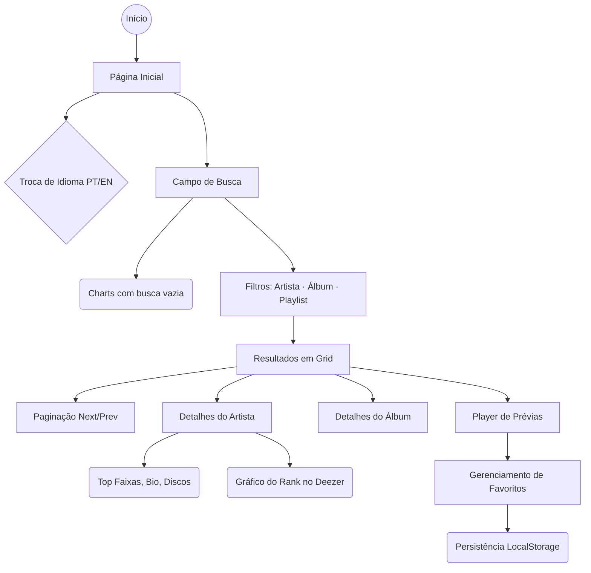

<p align="center">
  
</p>

# Vinyla

Vinyla é um player de música web imersivo, feito com React, TypeScript, Vite e Tailwind CSS, com visual em "Glassmorfismo". O catálogo e as prévias de 30 segundos vêm da API pública do [Deezer](https://www.deezer.com), sem login e sem conta.

**Link:** https://vinyla.jeansouza.dev/

É um projeto de portfólio, sem fins comerciais. Dados e prévias de música fornecidos pelo Deezer.

## O que dá para fazer

- Buscar artistas, álbuns e playlists, ou navegar pelos charts do Deezer quando a busca está vazia.
- Ver detalhes de artista (bio, top faixas pelo rank do Deezer, discografia), álbum e playlist, com link para a página no Deezer.
- Ouvir prévias de 30 segundos no próprio navegador, com fila, repetir, aleatório e letras sincronizadas (via [LRCLIB](https://lrclib.net)).
- Salvar favoritos com notas e ver as últimas faixas tocadas, tudo guardado no navegador (localStorage).
- Usar em português ou inglês.

## Executando o Projeto

Não precisa de chave de API nem de arquivo `.env`.

1. Instale as dependências:
   ```bash
   yarn
   ```

2. Inicie o servidor de desenvolvimento:
   ```bash
   yarn dev
   ```

## Scripts Úteis

- `yarn dev`: Inicia o servidor local.
- `yarn build`: Gera a build de produção.
- `yarn lint`: Executa a verificação de código.
- `yarn test`: Roda a suíte de testes com o Vitest.
- `yarn test:e2e`: Executa os testes de ponta a ponta (E2E) com Playwright.

## Como funciona

- **Dados:** a API do Deezer não envia cabeçalhos CORS, então as chamadas saem do navegador via JSONP (`src/lib/deezer.ts`) e são convertidas para os tipos do app em `src/lib/deezerMappers.ts`.
- **Player:** um único elemento `<audio>` toca as prévias. Os links de prévia expiram em cerca de 15 minutos, então cada faixa busca um link novo antes de tocar.
- **Sem backend:** o site é estático (GitHub Pages). Favoritos, notas e histórico ficam só no navegador de quem usa.

## Testes End-to-End (E2E)

O projeto utiliza **Playwright** para garantir a integridade dos fluxos principais. Os testes rodam em um ambiente isolado, com respostas da API do Deezer e áudio de prévia simulados.

### Fluxos Cobertos



| Arquivo | Funcionalidades Testadas |
| :--- | :--- |
| `smoke.spec.ts` | Carregamento inicial sem login e título da página. |
| `i18n.spec.ts` | Tradução dinâmica (PT/EN) e persistência do idioma entre rotas. |
| `artists.spec.ts` | Charts com busca vazia, renderização de cards e alternância de abas. |
| `search.spec.ts` | Busca por artista/álbum/playlist, paginação, estado sem resultados e navegação para detalhe. |
| `artist-detail.spec.ts` | Bio, top faixas, discografia e gráfico do rank (SVG). |
| `favorites.spec.ts` | Tocar uma prévia, favoritar e manter os favoritos após recarregar a página. |

### Executando os Testes E2E

Para rodar os testes localmente:

```bash
# Instalar navegadores do Playwright (apenas na primeira vez)
npx playwright install

# Executar testes em modo headless
yarn test:e2e

# Executar testes com interface visual (UI Mode)
npx playwright test --ui
```
